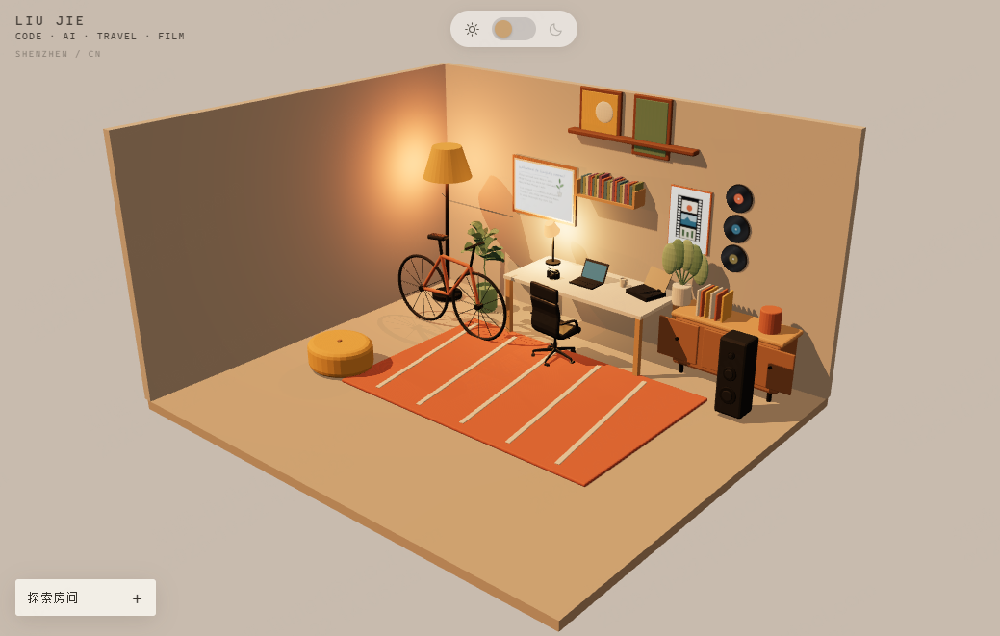

# Liu Jie's 3D Personal Studio

一个使用 Blender 和 Three.js 制作的可交互个人 3D 房间。

这个房间不仅是一个网页场景，也是我的个人数字空间，记录了我对编程、AI、旅行、电影和视频剪辑的兴趣。


## 关于我

我是 Liu Jie，关注软件开发、AI、独立旅行、电影和视频剪辑。

这个项目尝试把传统作品集变成一个可以探索的个人空间。
## 在线体验

👉 [进入我的 3D 房间](https://liujies-room.vercel.app)

建议使用电脑浏览器访问，以获得完整的 3D 交互体验。

## 可以体验什么

- 拖动鼠标探索整个房间
- 点击相机查看旅行照片
- 点击唱片机播放音乐
- 点击书架查看我的书单
- 点击电影海报查看喜欢的电影
- 点击音箱进入剪辑工作室
- 切换白天与夜晚模式
- 查看我的编程、AI、旅行和剪辑经历

## 技术实现

- Blender：房间建模与材质制作
- Three.js：3D 场景渲染与物体交互
- JavaScript：页面逻辑与交互系统
- Vite：开发与构建工具
- Vercel：网站部署

## 本地运行

```bash
npm install
npm run dev